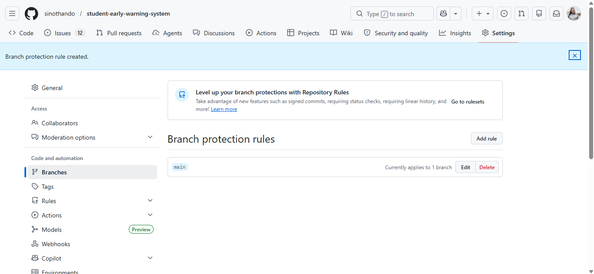

# Branch Protection Rules

## Purpose

Branch protection rules help maintain code quality and project stability by ensuring that all changes are reviewed and tested before merging into the main branch.

## Rules Applied

### Require Pull Request Reviews
At least one reviewer must approve changes before merging. This helps identify bugs and improves collaboration among team members.

### Require Status Checks to Pass
All automated tests in the CI pipeline must pass before pull requests can be merged. This prevents broken code from entering the main branch.

### Disable Direct Pushes
Developers cannot push directly to the main branch. All changes must go through pull requests, ensuring accountability and traceability.

## Benefits

- Improves code quality
- Prevents unstable code from being merged
- Encourages collaboration and peer review
- Ensures automated testing is always performed
- Supports continuous integration best practices

### Evidence

